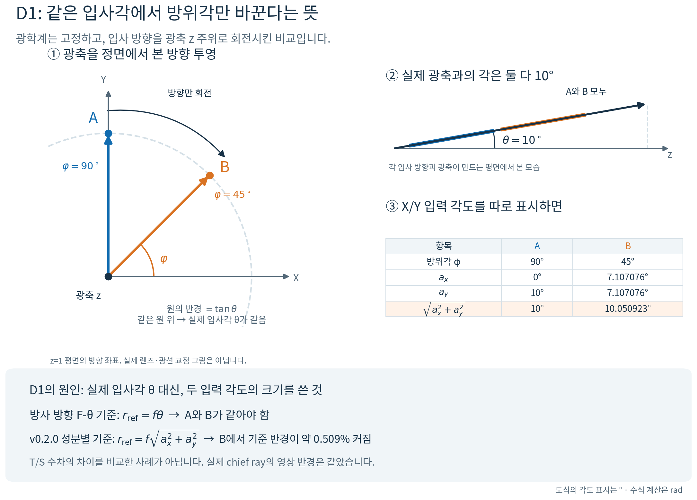

# D1: 같은 입사각에서 방위각만 바꾼다는 뜻

사용자가 말한 principal axis가 **광축**이라는 뜻이면 맞다. 광학계는 그대로 두고, **입사 방향을 광축 z 주위로 회전**시킨 것이다. 렌즈를 기울이거나 광선을 제멋대로 서로 다른 각도로 넣은 것이 아니다.

## 그림의 의미

- **실제 입사각 θ:** 광선 진행 방향과 광축 z 사이 각도.
- **방위각 φ:** 그 방향을 XY 평면에 투영했을 때 +X에서 재는 각도.
- **A:** Y 쪽으로 10° 기울어진 방향. φ=90°.
- **B:** X와 Y 사이 대각선 쪽으로 10° 기울어진 방향. φ=45°.

두 방향의 실제 입사각 θ는 모두 10°다. 이 그림의 왼쪽은 `z=1`에 투영한 **방향 좌표**이며 실제 렌즈 또는 광선 교점 위치가 아니다. 오른쪽 옆모습은 각 방향과 광축이 만드는 평면에서 본 것이다. 화살표는 입사 방향 벡터를 뜻하며, 광선이 어디에서 렌즈에 닿는지를 나타내지 않는다.

이 설명 그림은 이해하기 쉬운 **10°**를 사용했다. 원래 코드 리뷰의 수치 재현은 **θ=0.15 rad ≈ 8.59437°**였다.

## D1의 원인

현재 독립적인 X/Y field angle 입력을 $a_x,a_y$라고 할 때 방향은

$$
\mathbf d=\frac{(\tan a_x,\tan a_y,1)}{\sqrt{1+\tan^2 a_x+\tan^2 a_y}}
$$

이고 실제 광축과의 각도는

$$
\theta=\arctan\sqrt{\tan^2 a_x+\tan^2 a_y}
$$

이다. 이를 역으로 쓰면

$$
a_x=\arctan(\tan\theta\cos\varphi),\qquad
a_y=\arctan(\tan\theta\sin\varphi).
$$

그 결과 A의 입력은 `(0°,10°)`이고 B는 `(7.107076°,7.107076°)`다. **B에서 두 입력 각도의 단순한 제곱합 제곱근은 10.050923°이지, 실제 입사각 10°가 아니다.** 근축의 작은 각도에서는 그 차이가 작지만 두 좌표는 정확히 같은 정의가 아니다.

축상 기준의 방사 방향 F-θ 관계는

$$
r_{\rm ref}=f\theta,
\qquad D_{F\theta}=100\left(\frac{r_{\rm actual}}{f\theta}-1\right)
$$

이다. 이 설명에서 $f$는 축상 작은 field의 chief mapping으로 구한 각도-영상 높이의 선형 배율을 뜻한다. 근축 초점면에서는 통상의 초점거리와 대응하지만, 임의 영상면에서 무조건 EFL을 그대로 대입하라는 뜻은 아니다.

동축 회전대칭 광학계에서 θ를 고정하고 φ만 바꾸면 실제 chief ray의 영상 반경도 같고 기준 반경도 같으므로 이 왜곡 값은 같아야 한다. 그런데 기존 구현은 각 성분의 입력 각도에 기초한 좌표를 사용하여, 이 경우 기준 반경이 $f\sqrt{a_x^2+a_y^2}$에 해당했다. 따라서 A와 B에서 **기준 반경만 달라져서** 왜곡 수치가 달라졌다. 이 예에서 B의 기존 기준 반경은 A보다 약 0.509234% 커진다. 수식의 각도는 모두 rad로 계산한다.

원래 재현의 실제 chief 영상 반경은 A/B 모두 약 **12.7088433049 mm**로 일치했다. 따라서 확인된 D1은 광선 추적 자체의 회전대칭 실패가 아니라 **F-θ 기준 좌표의 정의 문제**다. 원래 θ=0.15 rad에서 기존 왜곡 값은 A **0.6852198936%**, B **0.3082209287%**였지만, 방사 방향 F-θ로 계산하면 둘 다 약 **0.6852198936%**다.

## T/S와의 관계

D1은 서로 다른 field 방위각의 왜곡 비교이며, **한 field의 T/S MTF 비교가 아니다.** 특히 Zemax FFT MTF의 T/S 표시 규칙과 기하학적인 meridional 평면의 정의를 혼동해서는 안 된다. MTF의 출력 방향 규칙은 이 F-θ 좌표 문제와 구별하여 확인할 항목이다.

## 근거와 범위

- 원본 재현: `history/lens_review_v0.2.0.md`의 LD01 및 `history/lens_results_v0.2.0.json`.
- 공식 정의 참고: [Ansys OpticStudio — Field Curvature and Distortion](https://ansyshelp.ansys.com/public/Views/Secured/Zemax/v26102/en/OpticStudio_User_Guide/OpticStudio_Help/topics/Field_Curvature_and_Distortion.html).
- 그림 수치는 위 방향 벡터의 삼각함수 관계로 직접 계산했다. 이 문서는 상용툴과 실행 결과를 대조했다고 주장하지 않는다.
- 광학계가 동축 회전대칭이고 STOP과 영상 기준면도 회전대칭인 비교에 대한 설명이다. 비대칭 광학계의 방위각 의존성을 금지하는 주장이 아니다.
